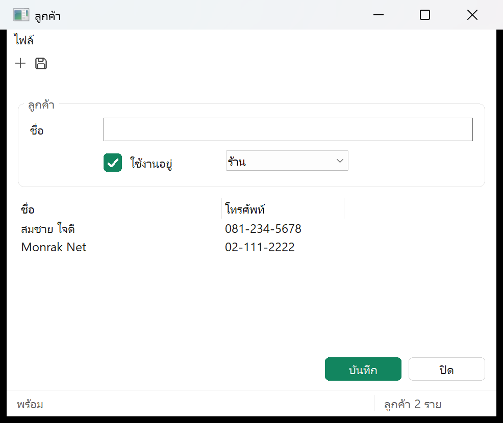

# Phai Studio

**Design Windows programs in Rust.** Drag controls onto a form and get real Win32 Rust code:
small programs, no runtime, Thai and every other script shaped by Windows itself.

ออกแบบโปรแกรม Windows ด้วย Rust แบบลากวาง แล้วได้โค้ด Win32 แท้ ตัวเล็ก ไม่ต้องมี .NET แสดงภาษาไทยถูก


Rust has editors, but no designer that produces native Win32 windows. Phai Studio is one, and
Phai Studio itself is built with what it makes - a single 1 MB exe.

## What it does

- **Design** - toolbox, drag to draw, move, resize, snap; multi-select, align and size (the
  Format menu), cut / copy / paste; properties; undo; several forms in tabs; a project explorer.
- **Menus and toolbars** - the form shows its title bar and menu bar on the canvas; menus and
  toolbars are edited as short, exact text.
- **Code** - saving writes `<form>_ui.rs` (always regenerated, never edited) and, once, `<form>.rs`
  for your handlers. A handler added in the designer never breaks your code; double-click a
  control to get its empty method.
- **Build and run** - New project, Build (Ctrl+B), Run (F5), Stop, Debug / Release, an error list
  and Cargo's output as it comes.
- **A code editor of its own** - Rust, TOML and CSS in colour, line numbers, a caret that steps
  over Thai vowel and tone marks as one letter, auto-indent, undo by word; double-click a file in
  the explorer or an error in the list to land on its line.
- **Templates** - a dialog with OK and Cancel, a main window with menu, toolbar and status bar, a
  form of labelled fields - laid out with Windows' own spacing.
- **Themes are CSS** - drop a `theme.css` into the project and every control follows; save the
  file and the running program changes at once.


```css
@import "phai:light";                 /* the standard theme, or "phai:dark" */
:root  { --accent: #c2410c; }          /* everything that used the accent follows */
button { border-radius: 10px; }
#save  { font-weight: 600; }
```

- **Thai and English built in** - text is keyed by its English; a test fails on any sentence
  without Thai.



## Getting started

You need Rust with the MSVC toolchain (`rustup`, Visual Studio Build Tools).

```
cargo run --release -p phai-studio
```

File > New project... picks an empty folder and makes a project that builds as it is. Or open the
sample: `cargo run -p phai-studio -- apps/sample/src/main_window.phf`.

## Installing Phai Studio / ติดตั้ง Phai Studio

1. Install Rust first - free, from <https://rustup.rs> (with the MSVC build tools it asks for).
   Phai Studio builds your programs with it. / ติดตั้ง Rust ก่อน (ฟรี) จาก rustup.rs
2. Run `PhaiStudio-<version>-setup.exe`. It installs for you alone, needs no administrator, and
   puts Phai Studio in the Start menu (and on the desktop if you like). / รันไฟล์ setup ไม่ต้องใช้สิทธิ์ผู้ดูแลระบบ
3. Remove it from Settings > Apps, as any program. / ถอนได้จาก Settings > Apps

The setup carries Phai Studio, the setup program its Publish uses, and the phai-ui library new
projects build with - so a project made on any computer builds there.

Making the setup from the source:

```
cargo build --release -p phai-studio -p phai-setup
cargo run --release -p phai-setup --example make_installer
```

It is written to `dist/PhaiStudio-<version>-setup.exe`. Quiet install: `/S`, another folder:
`/D=C:\path`.

## Guide in Thai / คู่มือภาษาไทย

`docs/help/` holds a Thai guide that opens from **Help > Phai Studio Guide** (F1) and works
offline: how to use Phai Studio, and eleven lessons on Rust for people who have never programmed -
variables, ownership, structs and enums, errors, collections, traits, modules and tests, reading
compiler errors, and threads. The pages are built from `docs/help-src/` with
`python docs/help-src/help_gen.py`.

คู่มือภาษาไทยใน `docs/help/` เปิดจากเมนู **ช่วยเหลือ > คู่มือ Phai Studio** (F1) ใช้ได้โดยไม่ต้องต่อเน็ต
มีวิธีใช้ Phai Studio และบทเรียน Rust 11 บทสำหรับคนที่เริ่มจากศูนย์

## The repository

| | |
|---|---|
| `crates/phai-ui` | the Win32 controls, CSS themes, dock/anchor layout, Thai/English, window photos |
| `crates/phai-form` | the `.phf` file, code generation, building a form live |
| `crates/phai-editor` | the code editor: piece table, editing model, syntax colours, the Win32 control |
| `crates/phai-design` | the Phai family's spacing, and ready-made windows (File > New from template) |
| `apps/studio` | Phai Studio |
| `apps/sample` | a program built from generated code - its test checks the generator |
| `apps/gallery` | every control, every theme, at any scale |
| `docs/phaiform.md` | the form file and the code it becomes |

Every window is checked by its picture: `PHAI_SHOT=out.png` photographs any phai-ui program.

## Code signing policy

The installer is not code-signed yet (free code signing for open source asks for wider adoption first). What would be signed, who
approves it, and what the program sends over the network:
[docs/code-signing-policy.md](docs/code-signing-policy.md).

## License

Two parts, two licenses - see [LICENSE](LICENSE). © 2026 Monrak Net (Kirati Kittikhun).

- **The libraries your programs use** (phai-ui, phai-data, phai-web, phai-pack, the setup program): **MIT**.
  Use them in any program, free or sold.
- **Phai Studio itself**: [PolyForm Perimeter 1.0.1](LICENSES/PolyForm-Perimeter-1.0.1.md). Free to use, change and
  share for any purpose - making programs you sell included - but not to offer a product that competes with Phai Studio.
  What Phai Studio writes into your projects is yours.

Versions up to 0.2.7 were MIT alone. "Phai Studio" and the bamboo logo are Monrak Net's. Part of the Phai family
(Phai ERP, PhaiDesk).
