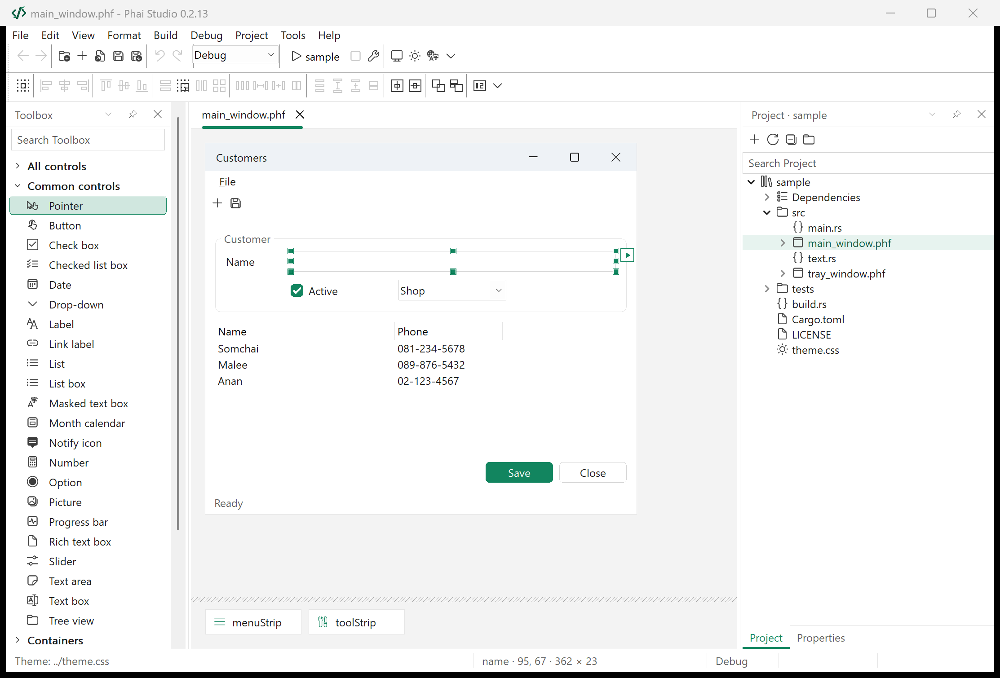
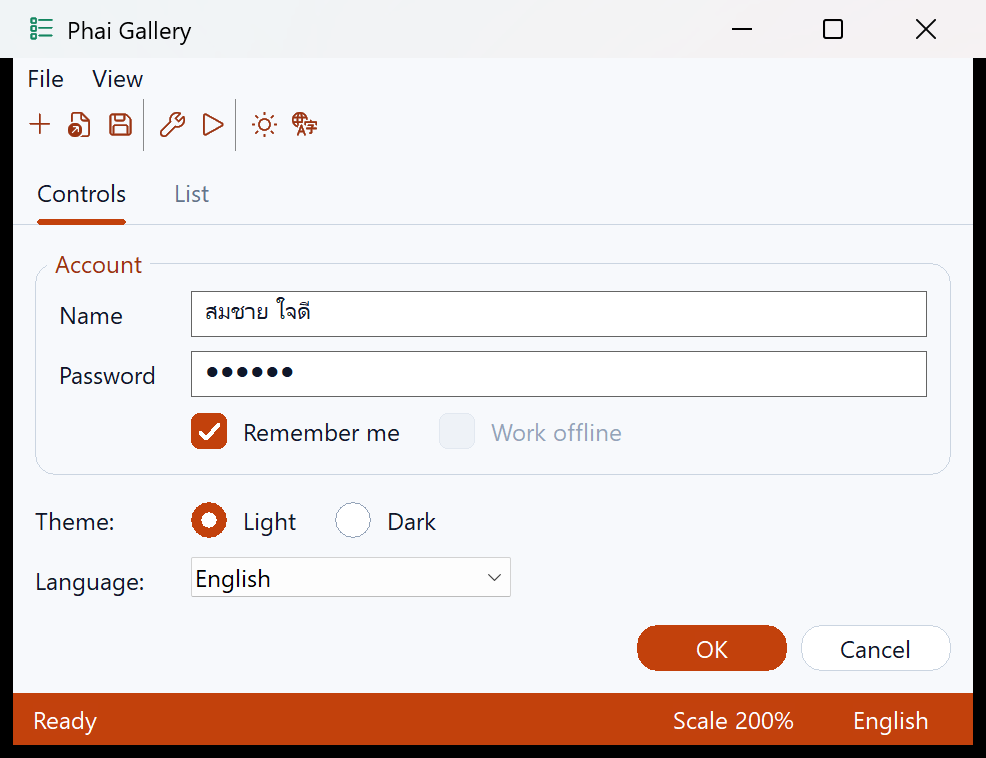

# Phai Studio

**Design Windows programs in Rust.** Drag controls onto a form and get real Win32 Rust code:
small programs, no runtime, Thai and every other script shaped by Windows itself.

ออกแบบโปรแกรม Windows ด้วย Rust แบบลากวาง แล้วได้โค้ด Win32 แท้ ตัวเล็ก ไม่ต้องมี .NET แสดงภาษาไทยถูก



Rust has editors, but no designer that produces native Win32 windows. Phai Studio is one, and
Phai Studio itself is built with what it makes - a single 1 MB exe.

## What it does

- **Design** - toolbox, drag to draw, move, resize, snap; multi-select, align and size (the
  Format menu), cut / copy / paste; properties; undo; several forms in tabs; a project explorer.
- **Menus and toolbars** - the form shows its title bar and menu bar on the canvas; menus and
  toolbars are edited as short, exact text.
- **Code** - saving writes `<form>_ui.rs` (always regenerated, never edited) and, once, `<form>.rs`
  for your handlers. A handler added in the designer never breaks your code; double-click a
  control to get its empty method.
- **Build and run** - New project, Build (Ctrl+B), Run (F5), Stop, Debug / Release, an error list
  and Cargo's output as it comes.
- **Templates** - a dialog with OK and Cancel, a main window with menu, toolbar and status bar, a
  form of labelled fields - laid out with Windows' own spacing.
- **Themes are CSS** - drop a `theme.css` into the project and every control follows; save the
  file and the running program changes at once.



```css
@import "phai:light";                 /* the standard theme, or "phai:dark" */
:root  { --accent: #c2410c; }          /* everything that used the accent follows */
button { border-radius: 10px; }
#save  { font-weight: 600; }
```

- **Thai and English built in** - text is keyed by its English; a test fails on any sentence
  without Thai.


## Getting started

You need Rust with the MSVC toolchain (`rustup`, Visual Studio Build Tools).

```
cargo run --release -p phai-studio
```

File > New project... picks an empty folder and makes a project that builds as it is. Or open the
sample: `cargo run -p phai-studio -- apps/sample/src/main_window.phaiform`.

## The repository

| | |
|---|---|
| `crates/phai-ui` | the Win32 controls, CSS themes, dock/anchor layout, Thai/English, window photos |
| `crates/phai-form` | the `.phaiform` file, code generation, building a form live |
| `crates/phai-design` | the Phai family's spacing, and ready-made windows (File > New from template) |
| `apps/studio` | Phai Studio |
| `apps/sample` | a program built from generated code - its test checks the generator |
| `apps/gallery` | every control, every theme, at any scale |
| `docs/phaiform.md` | the form file and the code it becomes |

Every window is checked by its picture: `PHAI_SHOT=out.png` photographs any phai-ui program.

## License

MIT - see [LICENSE](LICENSE). © 2026 Monrak Net. Part of the Phai family (Phai ERP, PhaiDesk).
